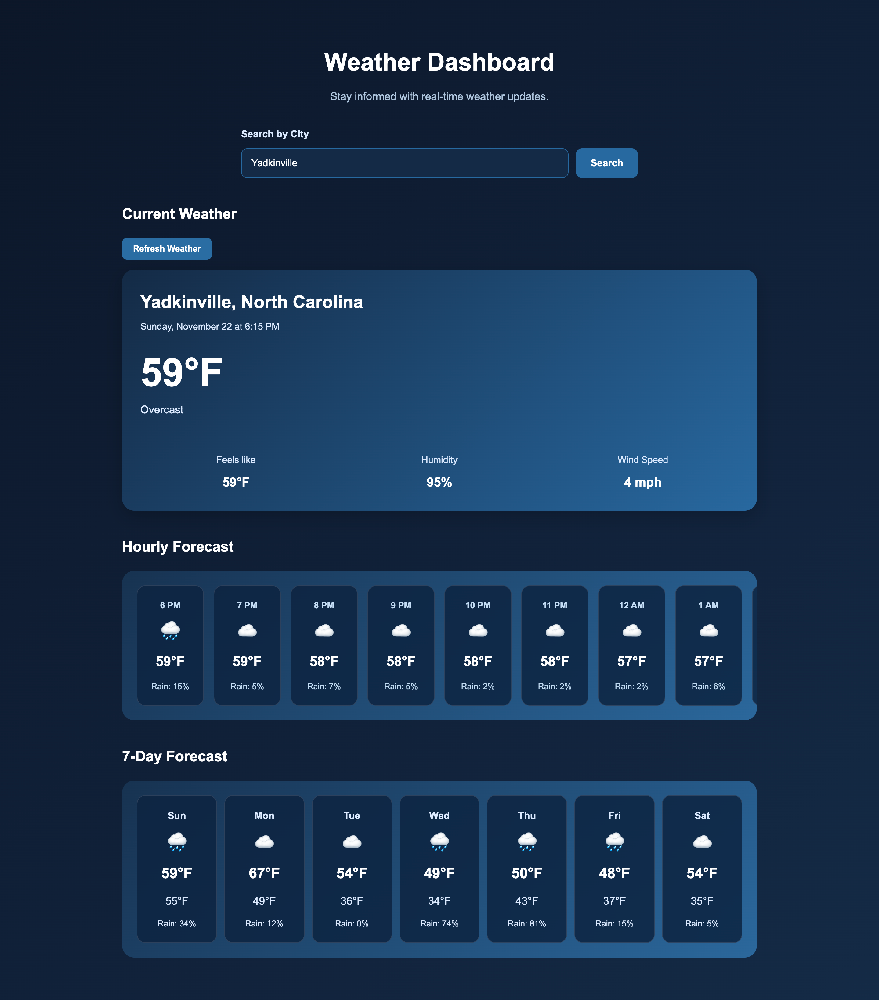
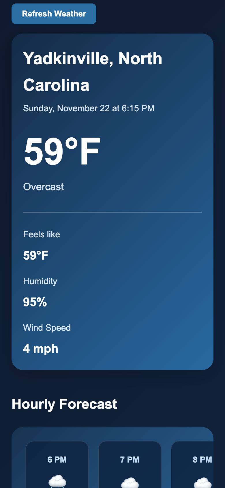
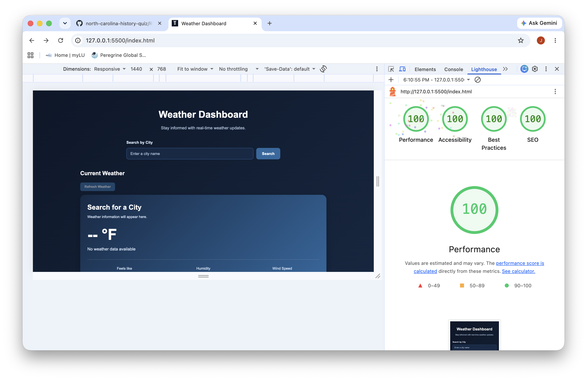

# Weather Dashboard

- An interactive, responsive web application designed to provide users with current weather conditions, hourly forecasts, and seven-day forecasts for cities worldwide.
- Built using HTML5, CSS3, and vanilla JavaScript, this project  demonstrates front-end development skills, including REST API integration, asynchronous JavaScript, DOM manipulation, responsive design, and interactive user feedback.

## Live Demo

- [View the Weather Dashboard](https://jallgood1213.github.io/weather-dashboard/)

## Project Overview

- The Weather Dashboard allows users to search for cities and retrieve live weather information using the Open-Meteo Weather and Geocoding APIs.
- Users can view current temperatures, weather conditions, humidity, wind speed, and upcoming forecasts. The application also provides location selection, weather refresh functionality, and helpful error messages when information cannot be retrieved.

## Features

- City search functionality using the Open-Meteo Geocoding API.
- Location selection when multiple matching cities are found. 
- Current weather conditions, including temperature, feels-like temperature, humidity, and wind speed.
- Horizontally scrollable 12-hour weather forecast.
- Seven-day forecast displaying high and low temperatures, weather conditions, and precipitation probabilities.
- Dynamic weather icons that account for daytime and nighttime conditions.
- Refresh functionality to retrieve updated weather information for the selected city.
- Keyboard-accessible search, location selection, and refresh controls.
- Accessibility features include visible focus indicators, status messages, and reduced-motion support.

## Technologies Used

- HTML5 - Provides the semantic structure of the application.
- CSS3 - Handles layout, styling, responsive design, and visual feedback.
- JavaScript - Manages API requests, asynchronous operations, DOM manipulation, event listeners, and dynamic weather updates.
- Open-Meteo Weather API - Provides current weather conditions and forecast data.
- Open-Meteo Geocoding API - Converts city searches into geographic coordinates.
- Visual Studio Code - Development environment.
- Chrome DevTools - Used for debugging and responsive design testing.
- Google Lighthouse - Used to evaluate performance, accessibility, best practices, and SEO.

## Installation

- This program runs in a modern web browser and does not require additional dependencies. An internet connection is required to retrieve live weather information.

1. Download or clone the project repository.
2. Open the `Weather_Dashboard` folder.
3. Open `index.html` in a modern web browser.

- Alternatively, open the project in Visual Studio Code and use the Live Server extension to launch the application.

## How to Use

1. Enter a city in the search field.
2. Click **Search** or press Enter/Return to retrieve matching locations.
3. If multiple locations are found, select the desired city from the dropdown menu.
4. Review the current weather conditions, including temperature, humidity, and wind speed. 
5. Scroll through the hourly forecast to view upcoming weather conditions.
6. Review the seven-day forecast for daily high and low temperatures and precipitation probabilities.
7. Click **Refresh Weather** to retrieve updated weather information for the selected location.

## Lighthouse Results

- Performance: 100
- Accessibility: 100 
- Best Practices: 100
- SEO: 100

- Results were obtained using Chrome Lighthouse on the application's initial page state. Scores may vary depending on the testing environment.

## Screenshots

### Desktop View

- The Weather Dashboard displaying current weather conditions, hourly forecasts, and the seven-day forecast on a desktop screen.

### Mobile View

- The responsive Weather Dashboard layout optimized for smaller screens.

### Lighthouse Results

- The Google Lighthouse audit displaying perfect scores across all four categories.

 

